# WorkshopWorkbench (Work table)

Page `/Plugins/Workbench` ("Workbench"). Place the job on the bed, set origin and height, follow the cut on a live map and prepare, design and run work: work zones (G54...), materials, cut area, a laser editor with layers, cutting a large design in parts, simulation, the running job and interrupted jobs that can be resumed step by step.

Version documented: 2.21.x on DWC 3.6.3 (hand-written JS plugin in `src/`).

## 1. Requirements

1. WorkshopService running (API, zones, live job state). 2. Machine modes defined (Laser used here; CNC and FFF follow the Machine plugin). 3. Optional: Camera and Vision for the camera layer and "find center".

## 2. Install

1. Install WorkshopService. 2. DWC > Settings > Plugins > Install `WorkshopWorkbench-<ver>.zip`; Start. Reload DWC. 3. Open *Plugins > Workbench* (also reachable from the side bar). 4. Verify: the bed map draws the cut area (dashed red rectangle), the status bar shows mode, zone (G55 here) and head position.

## 3. Functions

The page is "Workbench" (side menu: Plugins > Workbench). It has a top status bar, a left side bar of tools in two groups ("Work zone": Prepare, Zones, Materials, Work area, Find centre; "Design and cut": Laser editor, Cut in parts, Simulate job, Job in progress, Interrupted), the bed map in the centre with its toolbar, and at the right the "Inspector" of the chosen tool with a folded "How to use" help. The side bar shows names, or icons only when collapsed with the double arrow. Red rectangles mark the control described. The zone name is blurred in the pictures.

### Top status bar

#### Mode, state, zone, head position and lock
- What: the current mode chip (Laser), the machine state ("Free"), the active zone, the head position X Y Z and, when it applies, a lock chip ("Locked: machine off") that disables the tools that move the machine.
- Where: right side of the page header (picture 2, top).
- How: read only.

#### Commands button
- What: a button labelled "Commands" in the header.
- Where: top right of the page header (red rectangle, picture 2).
- How: press it to open the commands of the page.
- Watch out: ; its content is not described here.

### Bed map

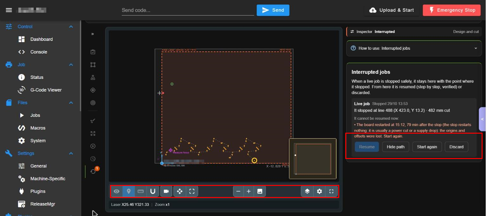

Picture 1: the bed map with the Interrupted inspector (right) and the toolbar under the map (red rectangle on the toolbar).

#### Bed map and cutting area
- What: the bed with its limits (here X -12..620, Y 0..523) and the dashed red "Area Laser (active)" with its corner coordinates. It shows the chosen zone, its Z point (magenta diamond "Measure focus"), the head and the job or design being prepared. A mini-map sits in a corner.
- Where: centre of the page (picture 1).
- How: drag to move the view, use the wheel or the zoom buttons to zoom.

#### Map toolbar
- What: under the map: eye (show or hide layers), pin (points), ruler (measure), magnet (snap), camera, move, fullscreen of the map; zoom - and +, image; layers, settings and page fullscreen at the right. The footer shows the laser position and the zoom ("Laser X25.46 Y321.33 | Zoom x1").
- Where: bar under the map (red rectangle, picture 1).
- How: press a button to turn that tool on or off; hover it for its name.
- Watch out: the camera and move tools can send the machine somewhere; they ask before moving.

#### Clamps (screws, stops)
- What: markers for the things that must not be touched: a clamp, a screw or a stop on the bed. Each one is a red rectangle on the map. With clamps on, the page warns when a work zone, the Laser editor design or a running job passes over one, and when the Z point would measure a clamp instead of the material. Clamps are off by default (they hide nothing and warn about nothing until you turn them on).
- Where: map toolbar > Layers > "Clamps (CNC)" > "Use clamps: NO / YES". Once on, the layer "Clamps" gets its own eye button. They are stored per machine in `0:/sys/workshop/config/clamps.json`.
- How: 1) Layers > "Use clamps: YES". 2) Tap a point on the map and choose "Mark clamp here": a red 30 x 20 mm rectangle appears centred there. 3) Tap the rectangle to set its name, position and size, or to delete it. 4) A path that goes over a clamp turns it brighter red and the job list shows "Shape(s) go over a clamp".
- Watch out: turning "Use clamps" on draws nothing by itself: the screen shows "No clamps marked yet" until you mark one. Turning it off hides them and silences every warning but does not delete them.

### Work zone

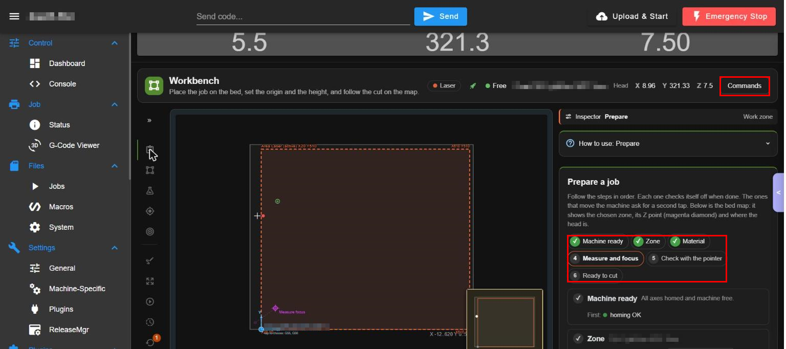

Picture 2: "Prepare a job": the six step chips (red rectangle).

#### Prepare a job (six steps)
- What: follows the steps in order, each one marks itself done: 1 Machine ready (all axes homed and the machine free, with what is missing and a "Home" button), 2 Zone, 3 Material, 4 Measure and focus, 5 Check with the pointer, 6 Ready to cut. The steps that move the machine ask for a second tap. The map shows the chosen zone, its Z point and the head.
- Where: Prepare (picture 2).
- How: 1. Do step 1 first. 2. Continue down the list. 3. Press the button of each step.
- Watch out: "Home", "Measure" and "Check with the pointer" MOVE the machine.

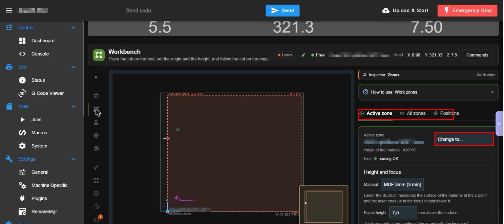

Picture 3: Zones: tabs "Active zone", "All zones", "Positions" and the menu "Change to..." (red rectangles).

#### Active zone and Change to...
- What: shows the active zone (the zone name is blurred), its origin and homing state, and the menu "Change to..." to pick another zone. Zones are files `p<N>.g` in `sys/workshop/zones`.
- Where: Zones > "Active zone" (picture 3).
- How: open "Change to..." and choose the zone.
- Watch out: changing the zone changes the origin of the next job.

#### Height and focus
- What: the material of the zone and the focus height (mm above the surface); for a laser the BLTouch measures the surface of the material at the Z point and the laser ends up at the focus height above it. A zone without a zone file needs one created with Edit / New zone to pick its measuring point. The thickness rule compares the material thickness with what the probe measures.
- Where: card "Height and focus" under the zone (picture 3).
- How: choose the material and type the focus height.
- Watch out: wrong focus height spoils the cut. Technician role.

#### Origin and zero
- What: X0 Y0 is where the pointer falls; the button "Go to X0 Y0 (pointer)" moves the machine there.
- Where: card "Origin and zero" (scroll the inspector down).
- How: press the button.
- Watch out: it moves the machine; not pressed.

#### All zones and Positions
- What: the list of all zones (to choose, edit or create) and the saved positions.
- Where: tabs "All zones" and "Positions" (red rectangle, picture 3).
- How: press a tab.

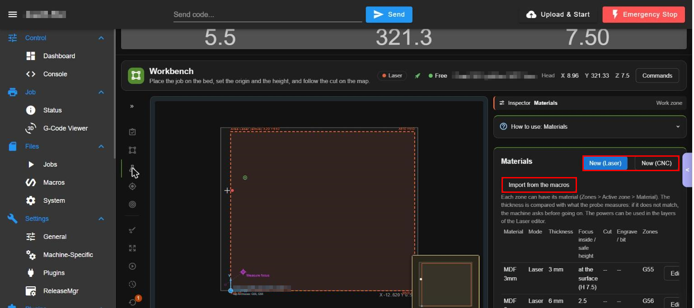

Picture 4: Materials: "New (Laser)", "New (CNC)" and "Import from the macros" (red rectangles).

#### Materials table
- What: the material list: material, mode, thickness, focus (inside / safe height; for example MDF 3 mm: at the surface H 7.5; MDF 6 mm: 2.5 mm inside) and the cut and engrave powers, with the zones that use it and an "Edit" button per row. Each zone can have its material; the thickness is compared with what the probe measures and the machine asks before going on if they differ. The powers can be used in the layers of the Laser editor. Focus rule used: H = 8.0 - 0.533 - lever(thickness).
- Where: Materials (picture 4).
- How: press "Edit" on a row.

#### New material and Import from the macros
- What: "New (Laser)" and "New (CNC)" create a material for that mode; "Import from the macros" reads the materials from the existing macros.
- Where: top of Materials (red rectangles, picture 4).
- How: 1. Press the button. 2. Fill the fields. 3. Save, or cancel.

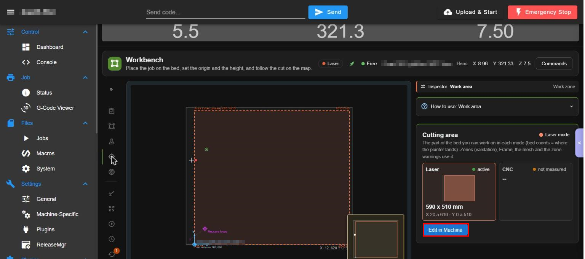

Picture 5: "Cutting area" per mode and "Edit in Machine" (red rectangle).

#### Cutting area per mode
- What: the part of the bed you can work on in each mode (bed coordinates where the pointer lands), used by the zones (validation), Frame, the mesh and the zone warnings. Laser: active, 590 x 510 mm, X 20..610 Y 0..510. CNC: not measured.
- Where: Work area (picture 5).
- How: read it.

#### Edit in Machine
- What: opens the Machine plugin to measure or change the area (the measurement is done there).
- Where: button under the cards (red rectangle, picture 5).
- How: press it.

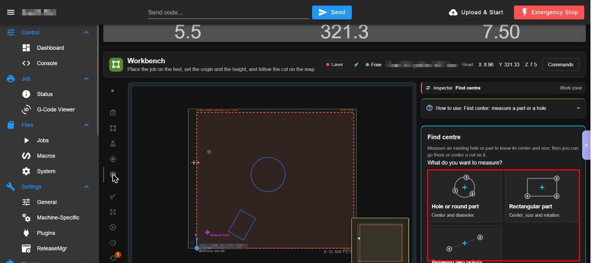

Picture 6: Find centre: the three measurement types (red rectangle).

#### Find centre (hole, rectangle, two points)
- What: measures an existing hole or part to know its centre and size, so you can go there or centre a cut on it. Choose "Hole or round part" (centre and diameter, 3 points), "Rectangular part" (centre, size and rotation) or "Between two points". The camera or the pointer find the points.
- Where: Find centre (picture 6).
- How: 1. Choose the type. 2. Follow the numbered points on the map.
- Watch out: it needs the camera or the pointer and may move the head.

### Design and cut

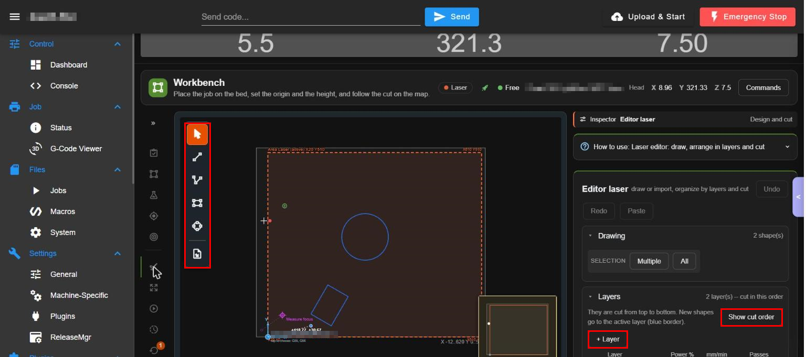

Picture 7: the Laser editor: tool palette on the map (red rectangle), "Show cut order" and "+ Layer".

#### Drawing tools
- What: draw or import a design: select, line, polyline, rectangle, node edit and import file; Undo, Redo and Paste buttons; the list "Drawing" with the number of shapes and the SELECTION buttons "Multiple" and "All".
- Where: the palette at the left of the map and the card "Editor laser" in the inspector (picture 7).
- How: 1. Choose a tool. 2. Draw on the map. 3. Use Undo / Redo.
- Watch out: the origin cannot be saved outside the cut area. The picture shows a sample drawing (a circle and a rotated square).

#### Layers and cut order
- What: "Layers" are cut from top to bottom; each has colour, power %, speed (mm/min) and passes; "+ Layer" adds one; "Show cut order" draws the order on the map. New shapes go to the active layer (blue border).
- Where: card "Layers" (red rectangles, picture 7).
- How: press "+ Layer", set power, speed and passes; press "Show cut order" to check.

#### Cut the design
- What: below the layers, the buttons to send the design to the machine.
- Where: bottom of the inspector (scroll down; not in the picture).
- How: 1. Finish the Prepare steps. 2. Review the layers. 3. Press the cut button and confirm.
- Watch out: starting a cut FIRES THE LASER and moves the machine: Wear the protective glasses and keep the lid closed.

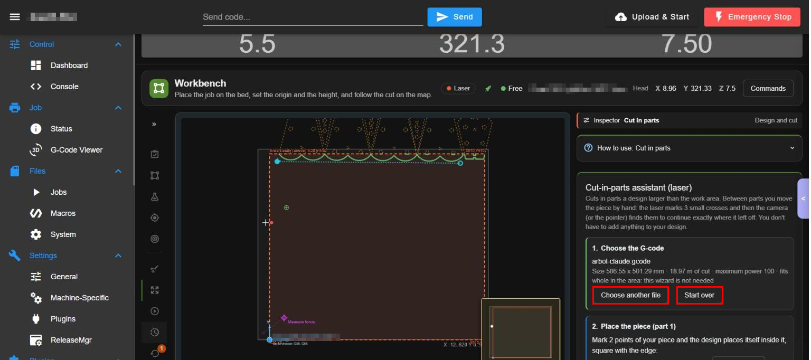

Picture 8: the cut-in-parts assistant (red rectangles on "Choose another file" and "Start over").

#### Cut in parts
- What: an assistant for a design bigger than the work area. Between parts you move the piece by hand; the laser marks 3 small crosses and then the camera (or the pointer) finds them to continue exactly where it stopped. Step 1 chooses the G-code (file, size, cut length, maximum power; it says if it fits whole), step 2 places the piece (part 1) by marking 2 points. You do not have to add anything to your design.
- Where: Cut in parts (picture 8).
- How: 1. Press "Choose another file" or keep the file. 2. Place the piece and mark the 2 points. 3. Follow each part; "Start over" resets the assistant.
- Watch out: the marks and the cut fire the laser and move the machine; not run.

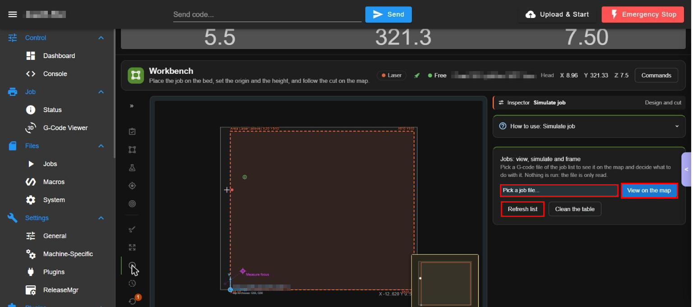

Picture 9: Simulate job: "Pick a job file...", "View on the map", "Refresh list", "Clean the table" (red rectangles).

#### Simulate job
- What: pick a G-code file of the job list to see it on the map and decide what to do with it. Nothing is run: the file is only read.
- Where: Simulate job (picture 9).
- How: 1. Open "Pick a job file...". 2. Press "View on the map". 3. Use "Refresh list" to read the list again and "Clean the table" to remove the drawing.
- Watch out: the view moves nothing; other buttons that appear after it (Frame) move the head.

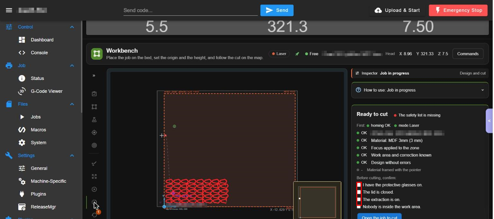

Picture 10: "Ready to cut": the safety list (red rectangle on the confirmation boxes).

#### Job in progress and the safety list
- What: the state of the cut: "Ready to cut" with the checks (homing OK, mode Laser, active zone, material, focus applied, work area and correction known, design without errors, material framed with the pointer) and the four confirmations to tick before cutting (protective glasses on, lid closed, extraction on, nobody inside the work area), then "Open the job to cut". While a job runs it follows the cut on the map (live) with pause and stop.
- Where: Job in progress (picture 10).
- How: 1. Check all lines are OK. 2. Tick the four boxes. 3. Press "Open the job to cut".
- Watch out: it starts a cut: not done. The red chip "The safety list is missing" says what is not confirmed.

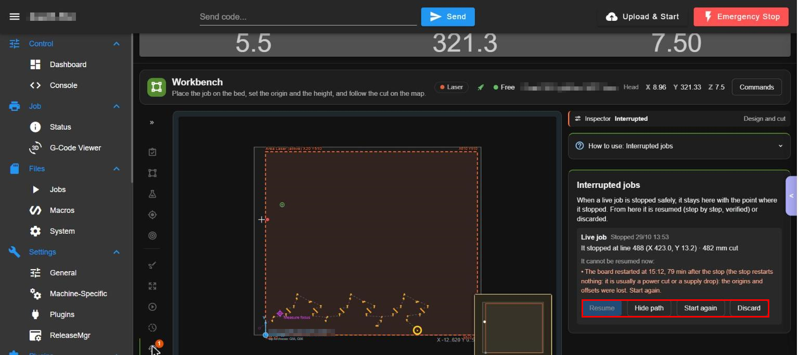

Picture 11: "Interrupted jobs" with Resume, Hide path, Start again and Discard (red rectangle).

#### Interrupted jobs: Resume, Hide path, Start again, Discard
- What: a live job stopped safely stays here with the point where it stopped (line, position, mm cut). "Resume" continues it step by step, verified; "Hide path" hides its path on the map; "Start again" restarts it; "Discard" forgets it. When it cannot be resumed (for example the board restarted after the stop and the origins were lost) the card says why and "Resume" is grey.
- Where: Interrupted (picture 11); a number badge on the side bar icon counts the interrupted jobs.
- How: 1. Read the reason. 2. Press "Resume" if it is enabled, or "Start again" or "Discard".
- Watch out: "Resume" and "Start again" move the machine and fire the laser; "Discard" deletes the saved point.

## 4. Settings

| Setting | Meaning | Default | If wrong |
|---|---|---|---|
| Active zone (G54..) | Work coordinate system | G54 | Cutting in another zone offsets the job |
| Cut area per mode | Where the tool can work | measured | Too big: the head can leave the bed |
| Material (thickness, focus, powers) | Per zone | per material | Wrong focus: bad cut |
| Layers (power, speed, passes) | Per layer in the editor | 100 % / 110 mm/min / 1 | Too much power burns |
| Snap, layers visible, zoom | View only | on | none |

Files: `sys/workshop/zones/p<N>.g`, `cutarea.g`, `sys/workshop/gcodes`.

## 5. Roles

Viewer: look only. Operator: move, run jobs in the allowed modes (default laser only). Technician: change zones, materials, area. Admin: all. Interrupted-job resume needs operator. Without users: admin.

## 6. API operations used

`workstate.*`, `workarea.*`, zones and material operations via `settings.*`, `jobs.*` (live job and resume), `camera.url`, `vision.*` for "find center", `motion.ask` for risky moves. See the API section of the service page.

## 7. Troubleshooting

1. "Locked: machine off": turn the motor power on (Control bar).
2. "homing missing X Y Z": press "Home" (it moves the machine) or use the Jog.
3. A zone has no file: create it in Zones (Edit / New).
4. Origin refused: it is outside the cut area; measure the area in Machine first.

<!-- permissions:start -->

## Permissions and what it changes

Risk: **Medium-high (moves the machine and runs laser jobs)**. Read this before installing; the full document is `security.md` of the Workshop plugins.

**DSF permissions:** none. It is a page of DWC (it runs in your browser) and everything it does goes through the API of `WorkshopService`, which applies the roles (viewer, operator, technician, administrator) in the server.

**Depends on:** `WorkshopService` (install it first, uninstall it last).

**Files it writes:**
- work zones `0:/sys/workshop/zones/p<N>.g`, `cutarea.g`
- materials, designs and positions under `0:/sys/workshop/`
- helper jobs in `0:/sys/workshop/gcodes/`

**Safety notes:**
- Laser jobs ask for confirmation, check the active zone and the cut area, and every `G1` it generates carries `S0` unless it must fire the laser.

Uninstalling removes the plugin folder; your data in `0:/sys/workshop/` and `/opt/dsf/conf/workshop-*.json` stays.

<!-- permissions:end -->

## 8. Limits

Laser editing is 2D shapes with layers; cutting by parts needs the camera or the pointer; nothing here replaces the physical emergency stop.

